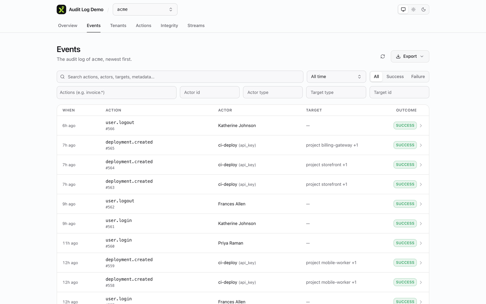
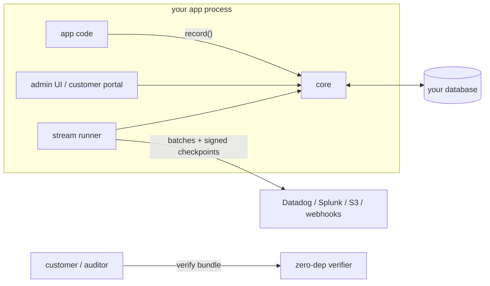
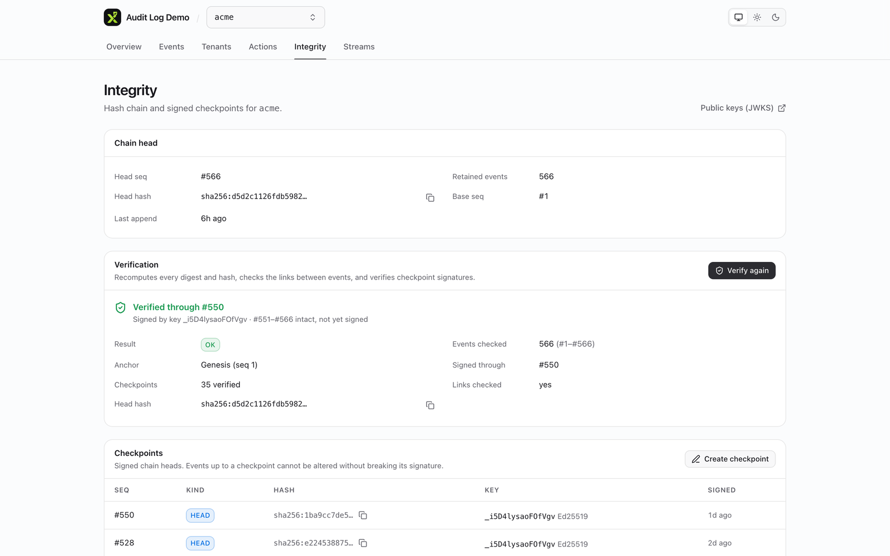
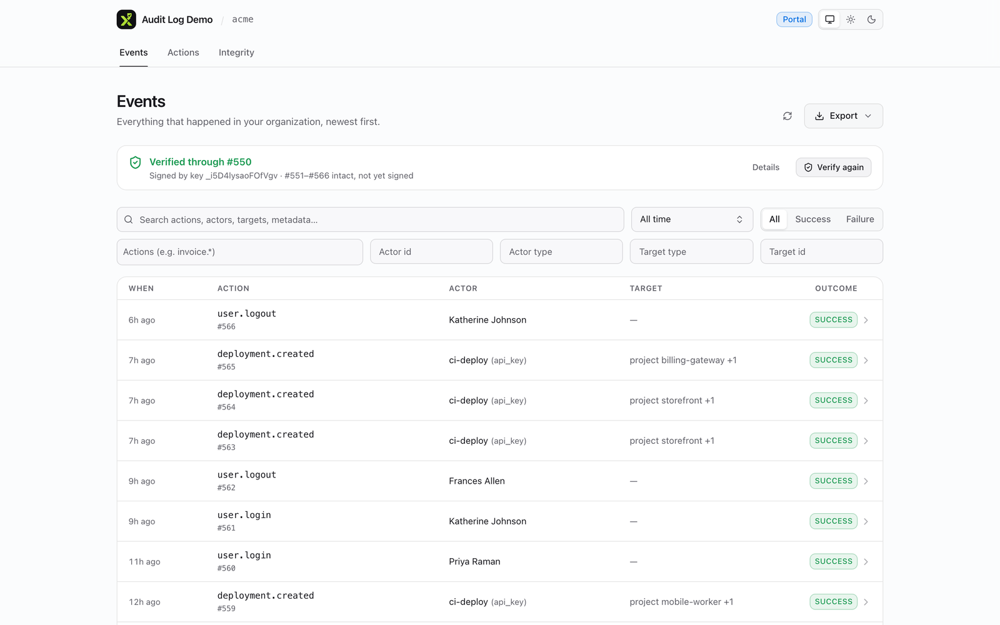
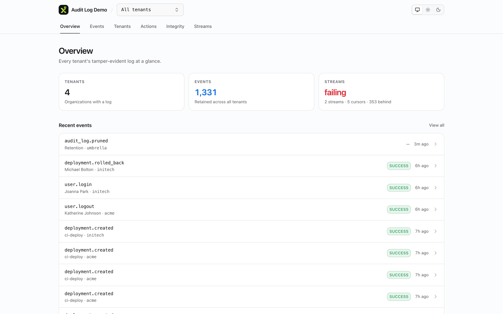
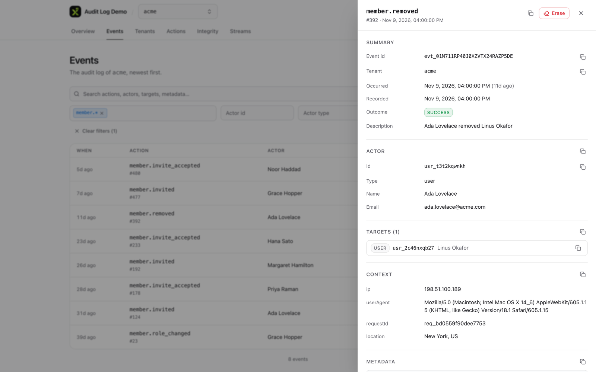
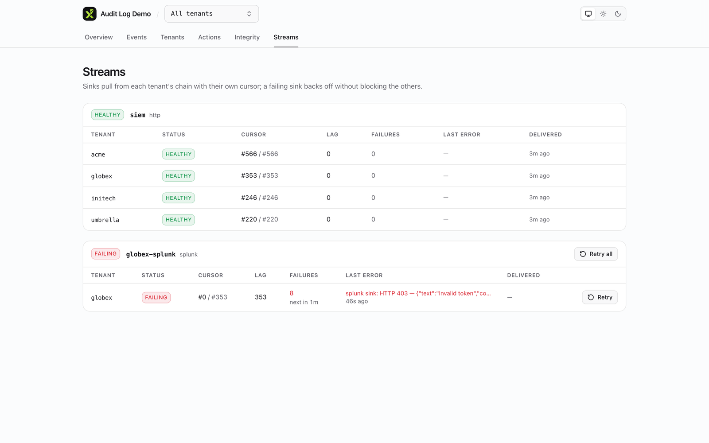
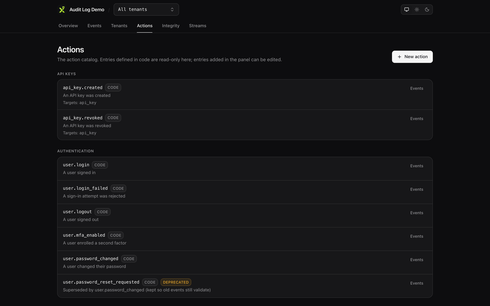
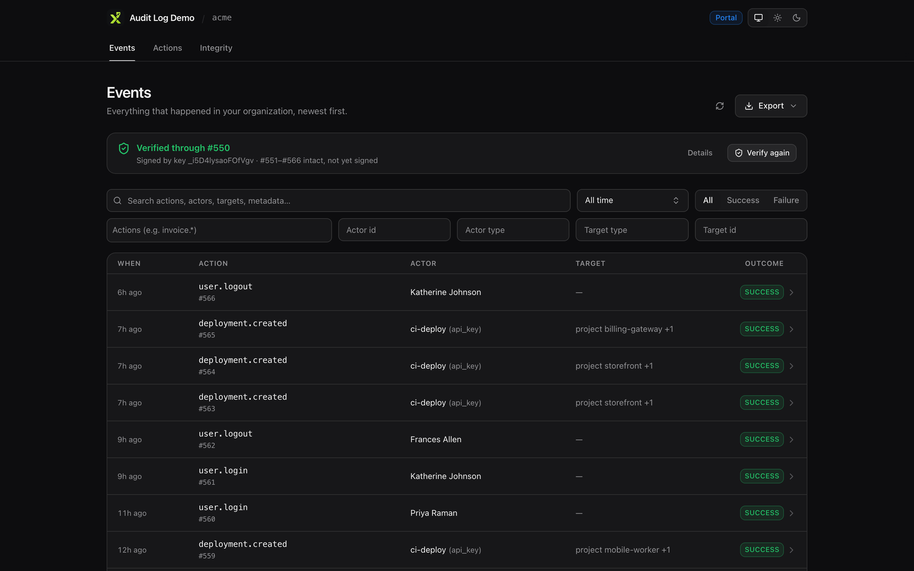

<div align="center">

<picture>
  <source media="(prefers-color-scheme: dark)" srcset="https://raw.githubusercontent.com/xantiagoma/xtandard-audit/main/docs/assets/lockup-horizontal-dark.png" />
  
</picture>

# @xtandard/audit

**Self-hosted, embeddable, tamper-evident audit-log control plane for B2B SaaS.**

Record typed audit events from your app, store them in the database you already run, and give every customer a verifiable, browsable, exportable log of what happened in their organization — no per-event SaaS pricing, no separate service to operate.

[](https://github.com/xantiagoma/xtandard-audit/actions/workflows/ci.yml)
[](https://www.npmjs.com/package/@xtandard/audit)
[](./LICENSE)
[](https://me.xantiagoma.com/xtandard-audit/)

**Documentation: [me.xantiagoma.com/xtandard-audit](https://me.xantiagoma.com/xtandard-audit/)** — guides and the full API reference.

<picture>
  <source media="(prefers-color-scheme: dark)" srcset="https://raw.githubusercontent.com/xantiagoma/xtandard-audit/main/docs/assets/ui-events-dark.png" />
  
</picture>

</div>

> `record()` is one call in your request handler. Every tenant gets its own hash chain with signed checkpoints, so your customers — and their auditors — can **verify** that nobody, including you, altered or deleted their history.

## Contents

- [Why another audit-log tool?](#why-another-audit-log-tool)
- [How it works](#how-it-works)
- [Quickstart](#quickstart)
- [Record your first events](#record-your-first-events)
- [Typed actions](#typed-actions)
- [Querying](#querying)
- [Tamper evidence](#tamper-evidence)
- [The customer portal](#the-customer-portal)
- [Exports and streaming](#exports-and-streaming)
- [Storage backends](#storage-backends)
- [Subpath exports](#subpath-exports)
- [Examples](#examples)
- [Screenshots](#screenshots)
- [CLI](#cli)
- [Documentation](#documentation)
- [Project status](#project-status)
- [The xtandard ecosystem](#the-xtandard-ecosystem)

## Why another audit-log tool?

Every B2B SaaS ends up needing an audit log its customers can see — it is on every enterprise security questionnaire. The options today:

- **WorkOS Audit Logs / Pangea** are excellent — and SaaS, priced per event, with your customers' activity data in someone else's cloud.
- **Retraced** (Apache-2.0) is a standalone service with Postgres, Elasticsearch and NSQ to operate, and has had no release since 2024.
- **ORM plugins** (paper_trail, audited, drizzle-audit, …) record row diffs, not tenant-facing business events, and have no viewer, export, streaming or verification.

`@xtandard/audit` is the 20% everyone needs, as a library: a typed event model, pluggable storage, keyset search, per-tenant hash chains with signed checkpoints and an offline verifier, a customer-facing portal you embed in your product, CSV/JSON exports, SIEM streaming, retention and GDPR erasure that keeps the chain verifiable. The full market survey is in [docs/research/landscape.md](docs/research/landscape.md).

Part of [the xtandard ecosystem](#the-xtandard-ecosystem): its closest siblings, [`@xtandard/webhooks`](https://github.com/xantiagoma/xtandard-webhooks) and [`@xtandard/flags`](https://github.com/xantiagoma/xtandard-flags), share the same architecture and design system.

## How it works



- **Record plane** — `record()` validates (typed per action), applies transforms (redact/mask/hash), chains the event into its tenant's hash chain and appends it. Synchronous-commit: it throws rather than silently dropping. A buffered `createRecorder()` exists for fire-and-forget hot paths, with retries, a fallback sink and backpressure.
- **Control plane** — query, export, verify, checkpoints, retention, erasure, the action catalog. Hook-guarded, authorized, and self-audited (exports and erasures land in the tenant's own log).
- **Streams** read the log by per-tenant sequence cursors — nothing sits on the record path, nothing is lost when a SIEM is down.

## Quickstart

<details>
<summary><b>Standalone (Docker)</b></summary>

```sh
docker run -p 3000:3000 -e STORAGE_DRIVER=memory ghcr.io/xantiagoma/xtandard-audit
# open http://localhost:3000
```

</details>

<details>
<summary><b>CLI (npx / bunx)</b></summary>

```sh
bunx @xtandard/audit serve   # STORAGE_DRIVER=file by default → ./.audit
```

</details>

<details>
<summary><b>Hono</b></summary>

```ts
import { Hono } from "hono";
import { auditPanel } from "@xtandard/audit/hono";
import { createMemoryStorage } from "@xtandard/audit/storage/memory";

const audit = auditPanel({ storage: createMemoryStorage(), basePath: "/audit" });
const app = new Hono();
app.route("/audit", audit);
```

</details>

<details>
<summary><b>Elysia</b></summary>

```ts
import { Elysia } from "elysia";
import { auditPanel } from "@xtandard/audit/elysia";
import { createMemoryStorage } from "@xtandard/audit/storage/memory";

new Elysia()
  .mount("/audit", auditPanel({ storage: createMemoryStorage(), basePath: "/audit" }))
  .listen(3000);
```

</details>

<details>
<summary><b>Express</b></summary>

```ts
import express from "express";
import { auditPanel } from "@xtandard/audit/express";
import { createMemoryStorage } from "@xtandard/audit/storage/memory";

const app = express();
app.use("/audit", auditPanel({ storage: createMemoryStorage(), basePath: "/audit" })); // before body-parser
app.listen(3000);
```

</details>

<details>
<summary><b>Bun</b></summary>

```ts
import { auditPanel } from "@xtandard/audit/bun";
import { createMemoryStorage } from "@xtandard/audit/storage/memory";

const audit = auditPanel({ storage: createMemoryStorage(), basePath: "/audit" });
Bun.serve({ port: 3000, fetch: audit.fetch });
```

</details>

## Record your first events

```ts
import { createAuditCore } from "@xtandard/audit";
import { createPostgresStorage } from "@xtandard/audit/storage/postgres";

const audit = createAuditCore({
  storage: createPostgresStorage({ url: process.env.DATABASE_URL! }),
});

// In the handler where the thing actually happens:
await audit.record({
  tenant: org.id, // the customer organization
  action: "member.role_changed",
  actor: { id: user.id, name: user.name, email: user.email },
  targets: [{ type: "user", id: member.id, name: member.name }],
  context: { ip, userAgent, requestId },
  metadata: { from: "member", to: "admin" },
});
```

One line of middleware fills `tenant`, `actor`, `ip`, `userAgent` and `requestId` for every event in a request (`auditContext()` in each framework adapter, or `runWithAuditContext` from `@xtandard/audit/context`).

## Typed actions

Declare your catalog once with any [Standard Schema](https://standardschema.dev) validator — valibot, zod, arktype — and `record()` is type-checked and validated:

```ts
import * as v from "valibot";
import { createAuditCore, defineActions } from "@xtandard/audit";

const actions = defineActions({
  "invoice.paid": {
    metadata: v.object({ invoiceId: v.string(), amount: v.number() }),
    targets: ["invoice"],
    description: "An invoice was paid",
    group: "Billing",
  },
  "member.removed": { targets: ["user"] },
});

const audit = createAuditCore({ storage, actions });
await audit.record({
  tenant,
  action: "invoice.paid",
  actor,
  metadata: { invoiceId: "inv_1", amount: 4200 },
});
//                                    ^ autocompletes; typos and wrong metadata are compile errors
```

## Querying

```ts
const page = await audit.query({
  tenant: "acme",
  actions: ["invoice.*"], // families
  actorId: "user_1",
  targetType: "invoice",
  from: "2026-01-01",
  search: "refund",
  limit: 50,
});
// { items, pageInfo: { hasNextPage, endCursor } } — keyset pagination, stable while new events arrive
const next = await audit.query({ tenant: "acme", cursor: page.pageInfo.endCursor! });
```

The envelope is `@xtandard/lib`'s `Paginated<T>` shape, so it plugs into `createPaginator` and its TanStack Query helpers unchanged. Details: [docs/QUERYING.md](docs/QUERYING.md).

## Tamper evidence

Every tenant has its own hash chain: each event commits to the previous one, and the privacy-bearing sections (actor, targets, context, metadata, description) are hashed separately — so personal data can be **erased** without breaking the chain, and the erasure itself is recorded. Signed checkpoints (Ed25519, public key served as a JWKS) bind the chain at points in time; streaming them to the customer makes a later rewrite detectable.

```ts
import { createAuditCore, ed25519Signer } from "@xtandard/audit";

const audit = createAuditCore({
  storage,
  signer: await ed25519Signer(JSON.parse(process.env.AUDIT_SIGNING_KEY!)),
});
const report = await audit.verify("acme"); // { ok, checked, anchor, signedThrough, erased, issues }
```

Customers verify exports offline with nothing but the bundle — `xtandard-audit verify --bundle acme.jsonl` or the zero-dependency `@xtandard/audit/verify`. Details: [docs/INTEGRITY.md](docs/INTEGRITY.md).



## The customer portal

The WorkOS-style audit-log viewer, self-hosted: your customers browse, filter, export and verify **their own** events inside your product, scoped by a signed token — no sessions, no proxy routes.

```tsx
// Your server: mint a token after your own auth (optionally narrowed by a view filter)
const token = await createPortalToken(process.env.PORTAL_SECRET!, org.id, {
  filter: { excludeActions: ["support.*"] },
});

// Your React frontend:
import { AuditPortal } from "@xtandard/audit/react";
import "@xtandard/audit/react/styles.css";

<AuditPortal apiBaseUrl="/audit" token={token} />;
```

<picture>
  <source media="(prefers-color-scheme: dark)" srcset="https://raw.githubusercontent.com/xantiagoma/xtandard-audit/main/docs/assets/ui-portal-dark.png" />
  
</picture>

Details: [docs/PORTAL.md](docs/PORTAL.md).

## Exports and streaming

- **Exports**: CSV (formula-injection safe), JSON, JSONL, and the **verifiable bundle** (events + checkpoints + JWKS in one file). Every export is itself audited.
- **Streams**: `httpSink`, `webhookSink` (Standard Webhooks-signed), `datadogSink`, `splunkSink`, `s3Sink`, `fileSink`, `consoleSink` — or bridge into [`@xtandard/webhooks`](https://github.com/xantiagoma/xtandard-webhooks) so each customer manages its own SIEM endpoints. At-least-once, per-tenant ordered, with backoff and lag shown in the admin UI.

Details: [docs/STREAMING.md](docs/STREAMING.md).

## Storage backends

Point it at what you already run — a four-method KV contract plus an optional native event-log capability for indexed queries ([ADR 0005](docs/ADR/0005-storage-kv-contract-event-log-capability.md)):

| Backend        | Subpath                                         | Event log               |
| -------------- | ----------------------------------------------- | ----------------------- |
| Memory         | `storage/memory`                                | native                  |
| Postgres       | `storage/postgres`                              | native (indexed SQL)    |
| Drizzle        | `storage/drizzle` + `drizzle/{pg,mysql,sqlite}` | native, your migrations |
| SQLite (Bun)   | `storage/sqlite`                                | native                  |
| libSQL / Turso | `storage/libsql`                                | native                  |
| MongoDB        | `storage/mongodb`                               | native                  |
| Redis          | `storage/redis`                                 | KV index fallback       |
| File           | `storage/file`                                  | KV index fallback       |
| unstorage      | `storage/unstorage`                             | KV index fallback       |
| Cloudflare KV  | `storage/cloudflare-kv`                         | KV index fallback       |

Details: [docs/STORAGE.md](docs/STORAGE.md).

## Subpath exports

| Import                                   | What you get                                                                    |
| ---------------------------------------- | ------------------------------------------------------------------------------- |
| `@xtandard/audit`                        | core, recorder, transforms, integrity, exports, streams, portal tokens, handler |
| `…/verify`                               | zero-dependency verifier for auditors (`verifyBundle`, `verifyChain`)           |
| `…/context`                              | ambient request context (AsyncLocalStorage)                                     |
| `…/schema`, `…/core`                     | types / the core alone                                                          |
| `…/testing`                              | test core + collecting sink + assertions                                        |
| `…/storage/*`, `…/drizzle/*`             | storage adapters (optional peers)                                               |
| `…/sinks/*`                              | stream sinks                                                                    |
| `…/drizzle-audit`                        | bridge from [drizzle-audit](https://github.com/xantiagoma/drizzle-audit)        |
| `…/auth/{none,basic,delegated}`          | authentication providers                                                        |
| `…/authorization/{none,roles,delegated}` | authorization providers                                                         |
| `…/hooks/log`                            | reference logging hook                                                          |
| `…/{elysia,elysia2,hono,express,bun}`    | framework adapters + `auditContext` middleware                                  |
| `…/react`, `…/react/styles.css`          | `<AuditDashboard>` + `<AuditPortal>` embeds                                     |

## Examples

`bun run demo` boots a seeded playground on http://localhost:7790 — four customer tenants with six weeks of realistic history (sign-ins, member and role changes, invoices paid / failed / refunded, API keys, SSO, deployments, exports, GDPR erasures), daily Ed25519 checkpoints, a pruned retention window, a SIEM stream catching up, a customer's Splunk stream stuck on a revoked token, and portal links per tenant.

| Example                                                                                                       | Shows                                                                              |
| ------------------------------------------------------------------------------------------------------------- | ---------------------------------------------------------------------------------- |
| [`hono`](examples/hono) / [`elysia`](examples/elysia) / [`express`](examples/express) / [`bun`](examples/bun) | panel + a team-settings app recording on real user actions via `auditContext`      |
| [`auth`](examples/auth)                                                                                       | none/basic/delegated + admin/auditor/viewer roles + portal tokens side by side     |
| [`portal-embed`](examples/portal-embed)                                                                       | `<AuditPortal>` inside a host React app, with a server minting portal tokens       |
| [`storage-drivers`](examples/storage-drivers)                                                                 | one contract, every serverless backend, the same query results                     |
| [`postgres`](examples/postgres)                                                                               | docker Postgres + the audit tables in your Drizzle schema, migrated by drizzle-kit |
| [`siem-streaming`](examples/siem-streaming)                                                                   | HTTP + signed-webhook + checkpoint-witness streams; failures, backoff, catch-up    |
| [`drizzle-audit-bridge`](examples/drizzle-audit-bridge)                                                       | drizzle-audit row changes → the chained, tenant-scoped log                         |
| [`verify-export`](examples/verify-export)                                                                     | signed bundles verified offline: `@xtandard/audit/verify` + CLI exit codes 0/2/1   |
| [`standalone-docker`](examples/standalone-docker)                                                             | compose file for the image, with Postgres                                          |

## Screenshots

|                                                                                                                                  |                                                                                                                                                        |
| -------------------------------------------------------------------------------------------------------------------------------- | ------------------------------------------------------------------------------------------------------------------------------------------------------ |
|                   |              |
|  |                                   |
|        |  |

`bun run demo` serves this seeded playground on http://localhost:7790.

## CLI

```txt
xtandard-audit serve                         # panel + streams from env
xtandard-audit record --tenant acme --action user.login --actor u_1
xtandard-audit query --tenant acme --actions 'invoice.*' --json
xtandard-audit export --tenant acme --format bundle > acme.jsonl
xtandard-audit verify --bundle acme.jsonl    # exit 0 valid, 2 valid but unanchored, 1 invalid
xtandard-audit checkpoint --tenant acme
xtandard-audit prune
xtandard-audit keygen                        # Ed25519 signing key + public JWKS
```

Env contract: [docs/DEPLOYMENT.md](docs/DEPLOYMENT.md).

## Documentation

The full documentation, with the API reference, is at **[me.xantiagoma.com/xtandard-audit](https://me.xantiagoma.com/xtandard-audit/)**. The guides, on GitHub:

[Getting started](docs/GETTING_STARTED.md) · [Architecture](docs/ARCHITECTURE.md) · [Querying](docs/QUERYING.md) · [Integrity](docs/INTEGRITY.md) · [Storage](docs/STORAGE.md) · [Streaming](docs/STREAMING.md) · [Portal](docs/PORTAL.md) · [Auth](docs/AUTH.md) · [Authorization](docs/AUTHORIZATION.md) · [Hooks](docs/HOOKS.md) · [UI](docs/UI.md) · [Adapters](docs/ADAPTERS.md) · [HTTP API](docs/HTTP_API.md) · [Deployment](docs/DEPLOYMENT.md) · [Testing](docs/TESTING.md) · [drizzle-audit](docs/DRIZZLE_AUDIT.md) · [Releases](docs/RELEASES.md) · [Brand](docs/BRAND.md) · [ADRs](docs/ADR)

## Project status

ZeroVer (`0.x`) and pre-first-publish: the surface is stabilizing, minor versions may break, and feedback shapes it — issues welcome. Anti-bloat is a core value: when a feature is composable from an existing primitive in ten lines, we document the recipe instead of shipping the subsystem.

## The xtandard ecosystem

`@xtandard/audit` is one of a family of open-source, MIT-licensed projects that share the xtandard name. They are independent of each other: use any of them on its own.

| Project                              | What it is                                                                                                                                                                                                      | Links                                                                                                                                                                      |
| ------------------------------------ | --------------------------------------------------------------------------------------------------------------------------------------------------------------------------------------------------------------- | -------------------------------------------------------------------------------------------------------------------------------------------------------------------------- |
| **`@xtandard/audit`** (this package) | A self-hosted, embeddable, tamper-evident audit-log control plane for B2B SaaS: a WorkOS Audit Logs alternative as a library                                                                                    | [Docs](https://me.xantiagoma.com/xtandard-audit/) · [GitHub](https://github.com/xantiagoma/xtandard-audit) · [npm](https://www.npmjs.com/package/@xtandard/audit)          |
| **`@xtandard/lib`**                  | Lightweight, type-safe TypeScript utilities with a zero-dependency core                                                                                                                                         | [Docs](https://me.xantiagoma.com/xtandard/) · [GitHub](https://github.com/xantiagoma/xtandard) · [npm](https://www.npmjs.com/package/@xtandard/lib)                        |
| **`@xtandard/flags`**                | A self-hosted, embeddable, OpenFeature-compatible feature-flag control plane with pluggable storage                                                                                                             | [Docs](https://me.xantiagoma.com/xtandard-flags/) · [GitHub](https://github.com/xantiagoma/xtandard-flags) · [npm](https://www.npmjs.com/package/@xtandard/flags)          |
| **`@xtandard/webhooks`**             | A self-hosted, embeddable, Standard Webhooks-compliant outbound-webhooks control plane: a Svix alternative as a library                                                                                         | [Docs](https://me.xantiagoma.com/xtandard-webhooks/) · [GitHub](https://github.com/xantiagoma/xtandard-webhooks) · [npm](https://www.npmjs.com/package/@xtandard/webhooks) |
| **`@xtandard/xyte`**                 | A Zyte API-compatible `/v1/extract` client and server that runs on any proxy provider, or none                                                                                                                  | [Docs](https://me.xantiagoma.com/xyte/) · [GitHub](https://github.com/xantiagoma/xyte) · [npm](https://www.npmjs.com/package/@xtandard/xyte)                               |
| **xtandard-image**                   | A self-hosted image and video processing server in Go and libvips: imgproxy-compatible URLs plus the imgix, Cloudinary, ImageKit, Cloudflare and Thumbor dialects, with a TypeScript client (`@xtandard/image`) | [Docs](https://me.xantiagoma.com/xtandard-image/) · [GitHub](https://github.com/xantiagoma/xtandard-image) · [npm](https://www.npmjs.com/package/@xtandard/image)          |

### Related

- [drizzle-cursor](https://github.com/xantiagoma/drizzle-cursor): cursor-based pagination for Drizzle ORM
- [drizzle-audit](https://github.com/xantiagoma/drizzle-audit): configurable audit logging for Drizzle ORM — capture row-level changes and forward them here with `@xtandard/audit/drizzle-audit`

## License

[MIT](./LICENSE)
