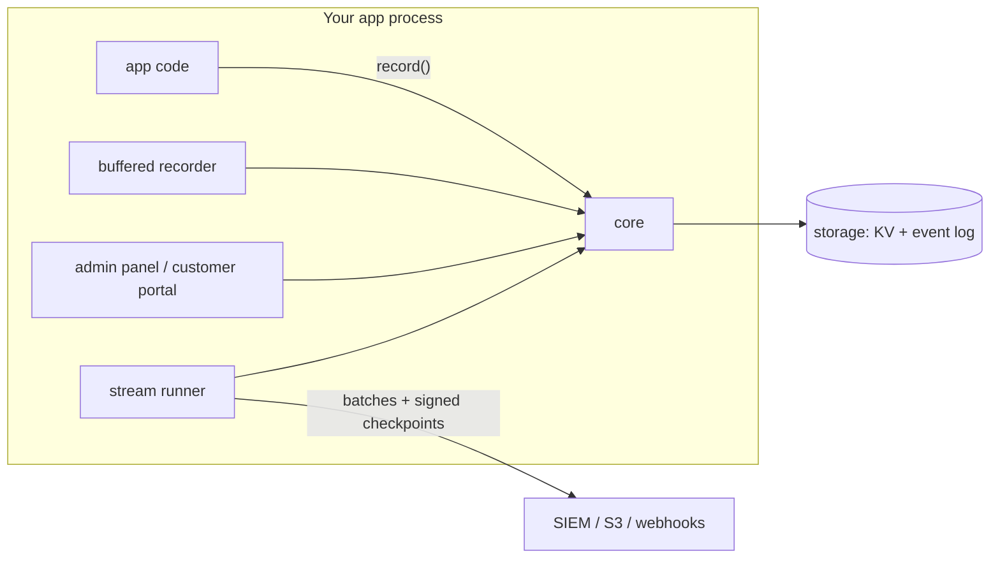

# Architecture

`@xtandard/audit` is one package with two planes, a stream runner, and a pluggable storage floor.

## The two planes

|                | Record plane                                                                        | Control plane                                                   |
| -------------- | ----------------------------------------------------------------------------------- | --------------------------------------------------------------- |
| Surface        | `record()`, `recordMany()`, `createRecorder()`                                      | query, export, verify, checkpoints, erasure, retention, catalog |
| Traffic        | hot, machine-driven                                                                 | rare, human-driven                                              |
| Guards         | validation, typed action schemas, `event.record` hook                               | auth, authorization, portal scoping, `before` hooks, self-audit |
| Failure stance | throw, never drop silently ([ADR 0002](ADR/0002-record-path-never-loses-events.md)) | fail loudly to the operator                                     |

## Anatomy of a record

1. **Resolve** — tenant and actor from the input, falling back to the ambient request context
   (`@xtandard/audit/context`); context merged under explicit keys.
2. **Validate** — structure (valibot), then the action's Standard Schema for `metadata`
   ([ADR 0012](ADR/0012-typed-actions-standard-schema.md)); with `strictActions`, unknown actions fail.
3. **Transform** — redact / mask / hash / omit, so the hash covers exactly what is stored.
4. **Gate** — `before` hooks get one `event.record` per tenant batch (quotas, policy).
5. **Chain** — under a per-tenant lock: read the head, assign contiguous `seq`s, compute the salted section
   digests and the chain hash linking each event to the previous one ([ADR 0004](ADR/0004-tamper-evidence-hash-chain-checkpoints.md)).
6. **Append** — native event-log drivers insert atomically and reject a stale head (`ChainConflictError` →
   re-chain and retry); KV drivers claim the head with compare-and-swap first ([ADR 0005](ADR/0005-storage-kv-contract-event-log-capability.md)).
7. **After** — `events.recorded` hooks, the `onRecord` tap, and an automatic checkpoint when one is due.

## Storage

One contract, two layers: the four-method KV contract (control data: catalog, chain heads, checkpoints,
stream cursors) and the optional native `EventLogStorage` capability (events with real indexes). Drivers
without it get the core's generic KV-index fallback. See [Storage](STORAGE.md).

## Streams

A stream is a sink plus a position in each tenant's sequence ([ADR 0008](ADR/0008-pull-based-streaming.md)).
The runner reads `eventsBySeq(tenant, cursor)`, calls the sink, and advances only on success; retention
never prunes past the slowest cursor. See [Streaming](STREAMING.md).

## Deployment shapes

1. **Embedded** (default) — panel + stream runner inside the host app; `record()` calls the core directly.
2. **Split** — the app records into shared storage; a separate process runs the panel/streams
   (`xtandard-audit serve`) against the same database.
3. **Standalone** — the Docker image serves the panel; apps ingest over HTTP
   (`POST /api/tenants/:tenant/events`).

## Scale posture

A library for the enormous middle: thousands to millions of events a month per app, from a process you
already run. Native drivers query with indexes and keyset pagination; the KV fallback lists index keys
per query (fine for small tenants with retention). Hashing uses the runtime's synchronous SHA-256 when
there is one (Bun, Node) — about a quarter of a millisecond per event end to end on a laptop. If you need
a dedicated analytics store over billions of events, stream into it.
