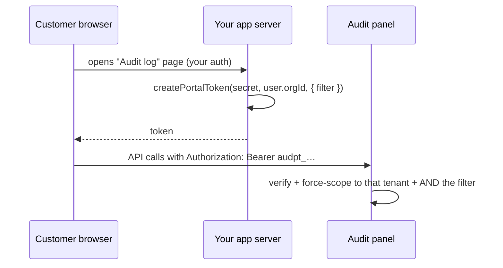

# Portal

The customer-facing audit log viewer is the flagship embed: your customers browse, filter, export and **verify their own** events from inside your product — the WorkOS "Audit Logs viewer" experience, self-hosted. It is not a second API or a second UI: the same routes and the same SPA bundle, force-scoped by a signed token, optionally narrowed by a server-side **view filter** (ADR 0006).

## The flow



## 1. Configure the panel

```ts
auditPanel({
  storage,
  portal: {
    secret: process.env.PORTAL_SECRET!, // any strong random string
    // allow: [...DEFAULT_PORTAL_ACTIONS]  ← the default grant, override to narrow/widen
  },
});
```

Default grant (`DEFAULT_PORTAL_ACTIONS`): `event:read`, `event:export`, `action:read`, `integrity:read` — browse, export and verify the tenant's own log, read the action catalog. Nothing mutating, no tenant list, no streams.

## 2. Mint tokens server-side

```ts
import { createPortalToken } from "@xtandard/audit";

// In a route handler of YOUR app, after your own auth:
app.get("/api/audit-portal-token", async (ctx) => {
  const user = await requireUser(ctx);
  return {
    token: await createPortalToken(process.env.PORTAL_SECRET!, user.orgId, {
      expiresIn: "30m",
      // Hide operator-only activity from customers:
      filter: { excludeActions: ["support.*", "billing.internal_*"] },
    }),
  };
});
```

`createPortalToken(secret, tenant, { expiresIn, filter })` — `expiresIn` defaults to `"1h"` (an audit portal is a read session, shorter than webhooks' `"7d"`). The token is `audpt_` + base64url(`{ tenant, exp, filter? }`) + `.` + base64url HMAC-SHA256 signature; verification is stateless, signature-first, constant-time. `verifyPortalToken(secret, token)` resolves to `{ tenant, expiresAt, filter? }`.

## 3. Embed

React (see [UI](./UI.md) for props):

```tsx
import { AuditPortal } from "@xtandard/audit/react";
import "@xtandard/audit/react/styles.css";

<AuditPortal apiBaseUrl="/audit" token={token} />;
```

The component sends the token as `Authorization: Bearer` on every API call; the panel answers `/config` with `portal: true`, `tenant` and the `allowed` actions, and the UI renders the reduced chrome (events, export, verify — no tenant switcher, no streams, read-only catalog).

## View filters

A token may carry a `filter` that is **AND-ed server-side into every query, export and single-event read** the bearer makes:

```ts
interface PortalFilter {
  actions?: string[]; // only these (exact names or "invoice.*" families)
  excludeActions?: string[]; // never these
  actorId?: string; // e.g. a member sees only their own activity
  targetType?: string;
  targetId?: string;
}
```

Client parameters can only **narrow** the view, never widen it:

| Client asks for                                                 | Result                                                     |
| --------------------------------------------------------------- | ---------------------------------------------------------- |
| `actions=…`                                                     | intersected with the token's `actions` (families included) |
| `excludeActions=…`                                              | unioned with the token's `excludeActions`                  |
| an `actorId`/`targetType`/`targetId` different from the token's | an empty result (not a 403, not the token's view)          |
| `tenant=other` on `GET /api/events`                             | an empty result                                            |
| an event id outside the view                                    | `404`                                                      |

Because a verifiable bundle is the **whole** chain, `format=bundle` exports are refused (`403`) for filtered tokens; unfiltered tokens can download one and check it with `xtandard-audit verify` or `@xtandard/audit/verify`. Tenant detail omits `count` for filtered tokens. `scopeQueryToPortal(query, grant)` and `portalCanSee(event, grant)` are exported if you build your own routes.

## Scoping guarantees

- Only the token's tenant: any request touching another `:tenant` is denied (`403`); the cross-tenant listing is forced to it.
- Only allowed actions: everything outside `portal.allow` is `403`. Even with a widened `allow`, the global action catalog stays read-only and streams stay invisible.
- Expired/tampered/malformed tokens: `401`, always — a presented-but-invalid portal token never falls back to host auth.
- The host's authorization provider is **not consulted** for portal principals (ADR 0006): portal scoping wins even if host policy is buggy-permissive.
- Portal exports are recorded into the tenant's own log as `audit_log.exported` with the actor `{ id: "portal:<tenant>", type: "portal" }` (self-audit).

## Operational notes

- Tokens are bearer credentials: HTTPS only, short `expiresIn`, and mint fresh per page load rather than storing them.
- Revocation before expiry = rotate `PORTAL_SECRET` (invalidates every outstanding token).
- Cross-origin embeds: set the panel's `cors` option (see [Adapters](./ADAPTERS.md)).
- The standalone/CLI accepts `PORTAL_SECRET` as an env var.
