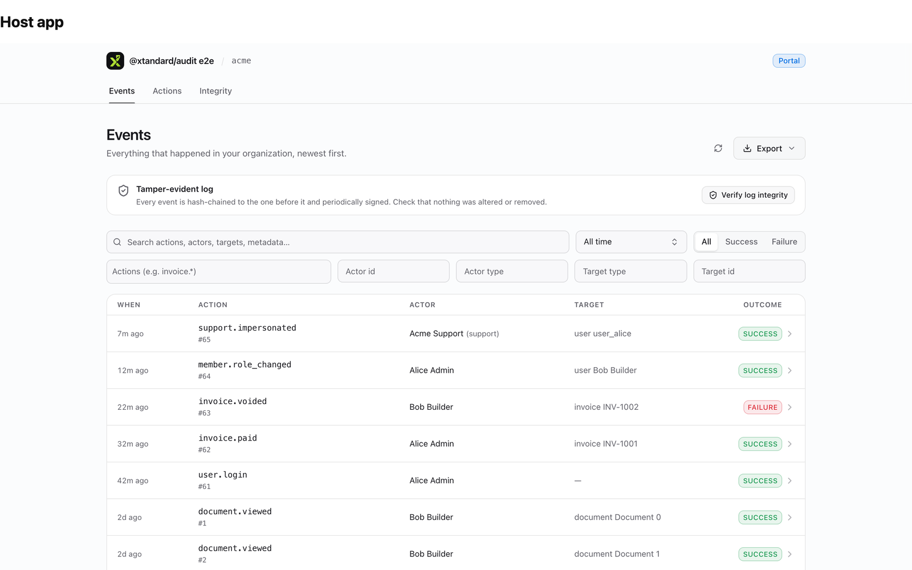
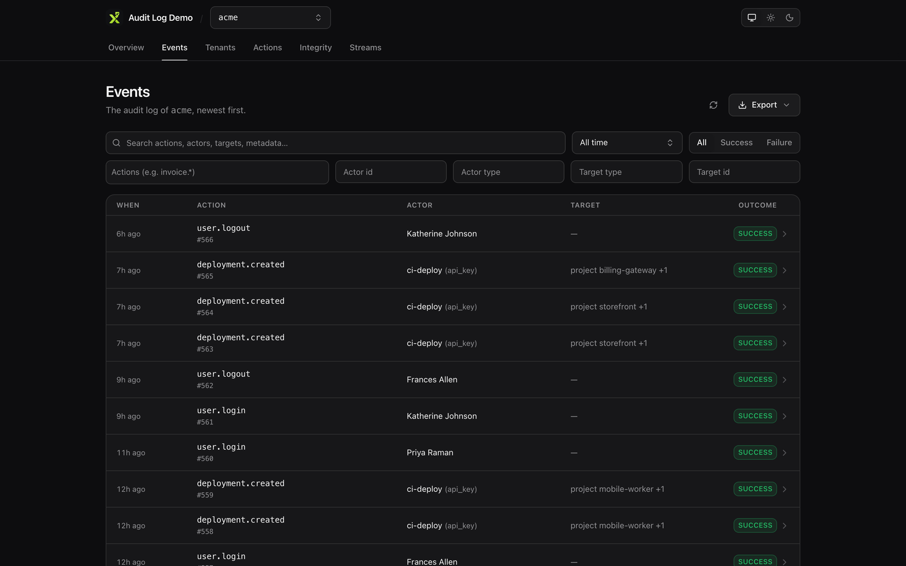
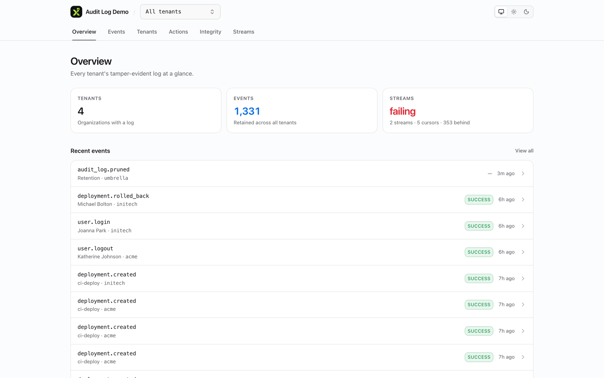
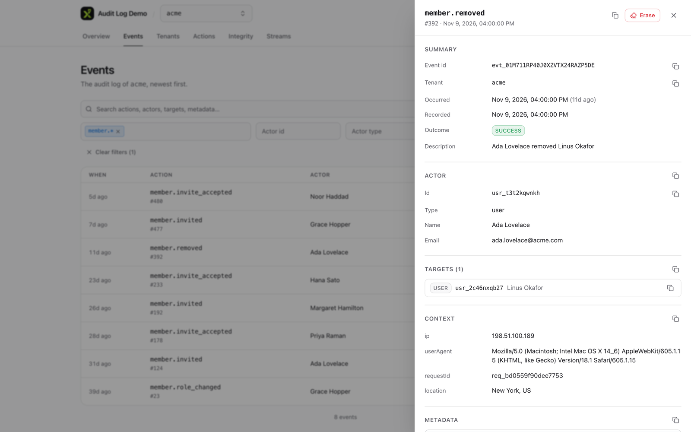
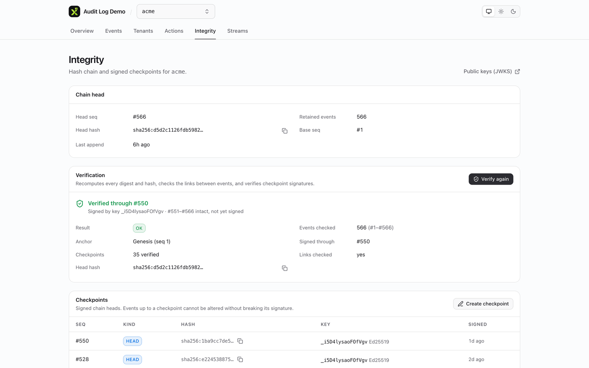
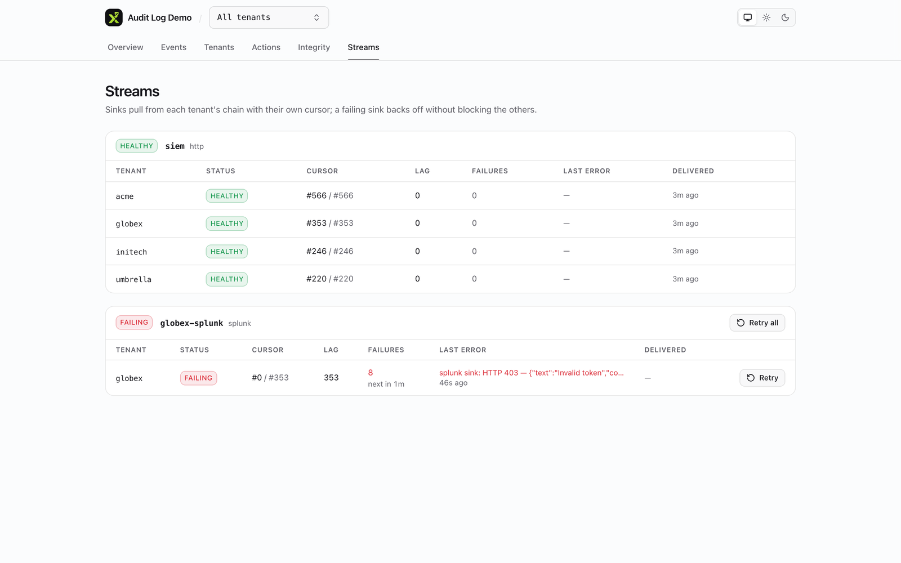
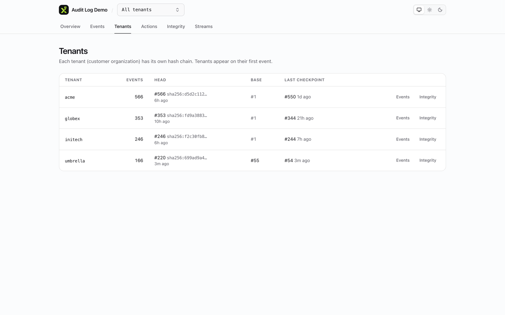
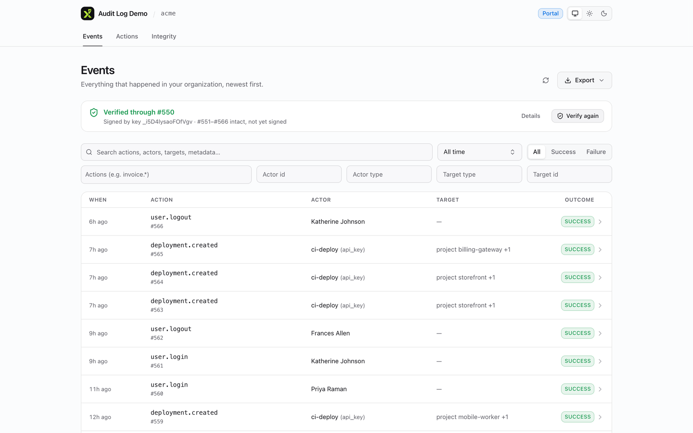

# UI

Two ways to get the interface: the **bundled SPA** every adapter serves automatically, and the **React embed** for hosts that want the dashboard or the customer-facing log viewer inside their own React tree. Same design system as `@xtandard/flags` and `@xtandard/webhooks` — a user of one dashboard feels zero friction in the others.

## `<AuditPortal>` — the flagship embed



Your customers browse, filter, export and **verify** their own audit log inside _your_ product:

```tsx
import { useEffect, useState } from "react";
import { AuditPortal } from "@xtandard/audit/react";
import "@xtandard/audit/react/styles.css";

export function AuditLogPage() {
  const [token, setToken] = useState<string>();
  useEffect(() => {
    // Your endpoint, authenticated by your app, minting a tenant-scoped token
    fetch("/api/audit-portal-token").then(async (r) => setToken((await r.json()).token));
  }, []);
  if (!token) return null;
  return <AuditPortal apiBaseUrl="/audit" token={token} />;
}
```

The component attaches the token as a Bearer credential on every API call; the panel force-scopes everything to the token's tenant and AND-s the token's view filter into every query and export ([Portal](./PORTAL.md)). The rendered chrome is the reduced portal set: the Events explorer (no tenant switcher, no erase), the export menu, a **Verify log integrity** panel ("Verified through #N, signed by key K"), and the read-only action catalog and integrity page when the token's grant includes them. Tokens are short-lived (`"1h"` by default): re-mint and pass the new `token` prop — the component picks it up without remounting.

## `<AuditDashboard>` — the full admin, embedded



```tsx
import { AuditDashboard } from "@xtandard/audit/react";
import "@xtandard/audit/react/styles.css";

<AuditDashboard apiBaseUrl="/audit" initialTenant="acme" />;
```

Props (both components unless noted):

| Prop                       | Default         | What it does                                                                                                                                    |
| -------------------------- | --------------- | ----------------------------------------------------------------------------------------------------------------------------------------------- |
| `apiBaseUrl`               | `""`            | Where the panel is mounted (`"/audit"`, or an absolute URL for a cross-origin panel)                                                            |
| `credentials`              | `"same-origin"` | `fetch` credentials mode; `"include"` for a cross-origin panel with cookie auth (enable `cors` on the panel)                                    |
| `fetch`                    | global `fetch`  | Custom fetch: inject headers / bearer tokens, instrument calls                                                                                  |
| `queryClient`              | internal        | Bring your own TanStack `QueryClient`                                                                                                           |
| `theme`                    | `"auto"`        | See [Theme](#theme)                                                                                                                             |
| `routing`                  | `"hash"`        | `"hash"` (never touches your router), `"browser"` (clean paths; serve the SPA under `routerBase`), `"memory"`, or a custom wouter location hook |
| `routerBase`               | `""`            | Mount path for `routing="browser"`                                                                                                              |
| `logoUrl`                  | from `/config`  | Navbar logo (replaces the title wordmark)                                                                                                       |
| `className`                | —               | Extra class on the wrapper                                                                                                                      |
| `initialTenant` (admin)    | all tenants     | Pre-select a tenant; `?tenant=` in the URL still wins                                                                                           |
| `token` (portal, required) | —               | The `audpt_…` portal token                                                                                                                      |

React 18/19 are optional peers — only this subpath needs them. TanStack Query, the primitives and the styles are bundled.

### Theme

The embed resolves one theme and applies it to its own wrapper (`<div class="xtandard-audit" data-theme="…">`) — it never writes to your document, and surfaces, text, borders, popups, toasts, the event drawer and code views all come from that one theme. The stylesheet is scoped under `.xtandard-audit`, so importing it cannot restyle your app.

| `theme`              | Behavior                                                                                                                                                                                                                                | Switcher |
| -------------------- | --------------------------------------------------------------------------------------------------------------------------------------------------------------------------------------------------------------------------------------- | -------- |
| `"auto"` (default)   | The panel's own system/light/dark switcher; the choice is persisted in `localStorage`.                                                                                                                                                  | shown    |
| `"inherit"`          | Follows your app, live: a `dark`/`light` class or `data-theme="dark\|light"` on `<html>` (then `<body>`) — what class- and attribute-based theme switchers set — falling back to the OS `prefers-color-scheme` when neither is present. | hidden   |
| `"light"` / `"dark"` | Forces one theme. Use it when your app tracks its theme some other way: pass your resolved value.                                                                                                                                       | hidden   |

```tsx
// App with a class-based switcher (`<html class="dark">`): just inherit.
<AuditPortal apiBaseUrl="/audit" token={token} theme="inherit" />

// Theme held in app state instead: pass the resolved value.
<AuditDashboard apiBaseUrl="/audit" theme={isDark ? "dark" : "light"} />
```

## The bundled SPA

|                                                                                                                 |                                                                                                                      |
| --------------------------------------------------------------------------------------------------------------- | -------------------------------------------------------------------------------------------------------------------- |
|  |     |
|      |               |
|          |  |

Served by every adapter at the mount point; no React required in the host. Views (each hidden when `/config.allowed` does not grant its read action):

| View      | What it does                                                                                                                                                                                                                                                                                                                                                                                                                                                                                                                                         |
| --------- | ---------------------------------------------------------------------------------------------------------------------------------------------------------------------------------------------------------------------------------------------------------------------------------------------------------------------------------------------------------------------------------------------------------------------------------------------------------------------------------------------------------------------------------------------------- |
| Overview  | tenant and event totals, the latest events across tenants, stream health                                                                                                                                                                                                                                                                                                                                                                                                                                                                             |
| Events    | the core screen: free-text search, actions (with family autocomplete — `invoice.*` — from the catalog), actor id/type, target type/id, outcome, time range (presets or custom); filters live in the URL; keyset pagination as you scroll; a row opens the **detail drawer** (actor, targets, context, metadata JSON, and the integrity block: seq, hash, prevHash, per-section digests, erased sections — all copyable); **Erase** (sections + reason, admin only); **Export** (CSV / JSON / JSONL / verifiable bundle) honoring the current filters |
| Tenants   | every chain: retained events, head seq + hash, prune base, last checkpoint                                                                                                                                                                                                                                                                                                                                                                                                                                                                           |
| Actions   | the grouped catalog; code-defined entries (`defineActions`) are read-only, panel-defined ones can be created, edited (description, group) and deleted                                                                                                                                                                                                                                                                                                                                                                                                |
| Integrity | per tenant: chain head, **Verify chain** (the `VerifyReport`: result, anchor, signed-through, checkpoints verified, issues, erasures), the checkpoints table, **Create checkpoint**, and a link to the public JWKS                                                                                                                                                                                                                                                                                                                                   |
| Streams   | one card per stream, one row per tenant cursor: lag behind the head, failures, next attempt, last error, last delivery, **Retry**                                                                                                                                                                                                                                                                                                                                                                                                                    |

The tenant switcher lives in the shell (`?tenant=` in the URL; "All tenants" lists across tenants, exports and integrity need one). Event deep links are `…/events?tenant=acme&event=evt_…&eventTenant=acme`. Readonly panels (`readonly: true`) show a **Read-only** badge and hide every mutation. Portal mode (a request authenticated by an `audpt_` token, or `?token=audpt_…` on the SPA URL) renders the reduced chrome from the same bundle.

Exports download through the API client (so portal tokens work) and are self-audited into the tenant's own log as `audit_log.exported`. A verifiable bundle can be checked offline with `@xtandard/audit/verify` ([Integrity](./INTEGRITY.md)).

## Design system

Byte-identical `styles.css` with `@xtandard/flags` and `@xtandard/webhooks`: Tailwind v4, neutral oklch palette with a single blue accent, dark mode via `data-theme`, JetBrains Mono for ids and hashes, Base UI primitives, lucide icons. The navbar carries the audit symbol (`src/ui/brand/symbol.svg`) on an ink chip and the tab uses `favicon.svg` ([Brand](./BRAND.md)). Custom look: override the CSS custom properties in `:root` (or on `.xtandard-audit` for the embed) after importing the stylesheet — every color/radius/font is a token.
