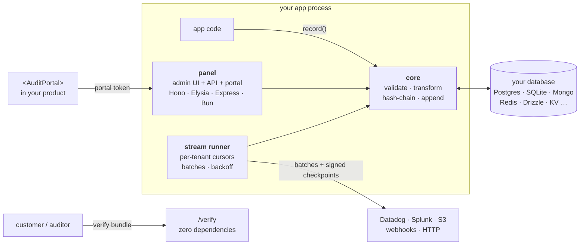

{/* The home page: written for the site; its content follows the root README.
scripts/sync.ts replaces the BASE, REPO and NPM tokens. */}

import { Card, CardGrid, LinkCard, Tabs, TabItem } from "@astrojs/starlight/components";

```sh
npm install @xtandard/audit
```

A WorkOS Audit Logs alternative as a library. `record()` is one call in your request handler.
Every tenant gets its own hash chain with signed checkpoints, so your customers, and their
auditors, can **verify** that nobody, including you, altered or deleted their history.

## Why @xtandard/audit

<CardGrid>
  <Card title="Typed events" icon="seti:typescript">
    Declare your action catalog once with any Standard Schema validator (valibot, zod, arktype):
    `record()` autocompletes actions, and wrong metadata is a compile error and a runtime error.
  </Card>
  <Card title="Tamper evidence" icon="approve-check">
    A hash chain per tenant, sectioned digests so personal data can be erased without breaking it,
    and Ed25519-signed checkpoints that a zero-dependency verifier checks offline.
  </Card>
  <Card title="A customer portal" icon="laptop">
    Your customers browse, filter, export and verify their own events inside your product, scoped
    by a signed token: no sessions, no proxy routes.
  </Card>
  <Card title="Exports & SIEM streaming" icon="rocket">
    CSV, JSON and a verifiable bundle; at-least-once, per-tenant ordered streams to HTTP, Standard
    Webhooks, Datadog, Splunk, S3 or files. Nothing sits on the record path.
  </Card>
  <Card title="Your storage" icon="list-format">
    Postgres, SQLite, libSQL, Drizzle, MongoDB, Redis, unstorage, Cloudflare KV, files or memory:
    a four-method KV contract plus an optional native event log for indexed queries.
  </Card>
  <Card title="Framework adapters" icon="puzzle">
    Mount the admin UI and API in Hono, Elysia (1 and 2), Express or Bun, and fill tenant, actor,
    IP and request id for every event with one `auditContext()` middleware.
  </Card>
</CardGrid>

## A quick taste

<Tabs syncKey="home-taste">
<TabItem label="Record">

```ts
import { createAuditCore } from "@xtandard/audit";
import { createPostgresStorage } from "@xtandard/audit/storage/postgres";

const audit = createAuditCore({
  storage: createPostgresStorage({ url: process.env.DATABASE_URL! }),
});

// In the handler where the thing actually happens:
await audit.record({
  tenant: org.id, // the customer organization
  action: "member.role_changed",
  actor: { id: user.id, name: user.name, email: user.email },
  targets: [{ type: "user", id: member.id, name: member.name }],
  metadata: { from: "member", to: "admin" },
});
```

Synchronous-commit: `record()` validates, chains and appends, and throws rather than silently
dropping. A buffered `createRecorder()` covers fire-and-forget hot paths.
[Quickstart →](@BASE@/guides/quickstart/)

</TabItem>
<TabItem label="Type">

```ts
import * as v from "valibot";
import { createAuditCore, defineActions } from "@xtandard/audit";

const actions = defineActions({
  "invoice.paid": {
    metadata: v.object({ invoiceId: v.string(), amount: v.number() }),
    targets: ["invoice"],
    group: "Billing",
  },
  "member.removed": { targets: ["user"] },
});

const audit = createAuditCore({ storage, actions });
await audit.record({
  tenant,
  action: "invoice.paid", // autocompletes; typos are compile errors
  actor,
  metadata: { invoiceId: "inv_1", amount: 4200 },
});
```

The catalog also feeds the admin UI's action filter and the portal.
[Quickstart →](@BASE@/guides/quickstart/)

</TabItem>
<TabItem label="Query">

```ts
const page = await audit.query({
  tenant: "acme",
  actions: ["invoice.*"], // families
  actorId: "user_1",
  from: "2026-01-01",
  search: "refund",
  limit: 50,
});
// { items, pageInfo: { hasNextPage, endCursor } }
const next = await audit.query({ tenant: "acme", cursor: page.pageInfo.endCursor! });
```

Keyset pagination, stable while new events arrive, executed natively by the SQL and MongoDB
drivers. [Querying →](@BASE@/concepts/querying/)

</TabItem>
<TabItem label="Verify">

```ts
import { verifyBundle } from "@xtandard/audit/verify";

// The customer's (or their auditor's) side: nothing but the exported bundle and Web Crypto.
const report = await verifyBundle(await Bun.file("acme.audit.jsonl").text());
console.log(report.ok ? `verified ${report.checked} events` : report.issues);
```

Or `xtandard-audit verify --bundle acme.jsonl` from the CLI. Your side runs the same check with
`await audit.verify("acme")`. [Tamper evidence →](@BASE@/concepts/integrity/)

</TabItem>
<TabItem label="Portal">

```tsx
// Your server, after your own auth (optionally narrowed by a view filter):
const token = await createPortalToken(process.env.PORTAL_SECRET!, org.id, {
  filter: { excludeActions: ["support.*"] },
});

// Your React frontend:
import { AuditPortal } from "@xtandard/audit/react";
import "@xtandard/audit/react/styles.css";

<AuditPortal apiBaseUrl="/audit" token={token} />;
```

The WorkOS-style audit-log viewer, self-hosted and tenant-scoped.
[Customer portal →](@BASE@/ui/portal/)

</TabItem>
<TabItem label="Stream">

```ts
import { auditPanel } from "@xtandard/audit/hono";
import { datadogSink } from "@xtandard/audit/sinks/datadog";

const panel = auditPanel({
  core: audit,
  basePath: "/audit",
  streams: [{ name: "datadog", sink: datadogSink({ apiKey: process.env.DD_API_KEY! }) }],
});
app.route("/audit", panel);
```

Streams read the log by per-tenant sequence cursors with backoff, so a SIEM outage loses nothing.
[Exports & streaming →](@BASE@/concepts/streaming/)

</TabItem>
</Tabs>

## How it fits together



The **record plane** (`record()`) is the hot path; the **control plane** (query, export, verify,
checkpoints, retention, erasure) is hook-guarded, authorized and self-audited: exports and
erasures land in the tenant's own log. [Architecture →](@BASE@/concepts/architecture/)

## Guides

<CardGrid>
  <LinkCard
    title="Getting started"
    href="@BASE@/getting-started/"
    description="Install, create the core, capture request context, record, mount the panel, stream and verify."
  />
  <LinkCard
    title="Tamper evidence"
    href="@BASE@/concepts/integrity/"
    description="The hash chain, signed checkpoints, offline verification, erasure and retention."
  />
  <LinkCard
    title="Storage"
    href="@BASE@/storage/"
    description="The KV contract, the native event log, every adapter and how to choose one."
  />
  <LinkCard
    title="Customer portal"
    href="@BASE@/ui/portal/"
    description="Mint scoped tokens server-side, narrow them with view filters, embed the portal."
  />
  <LinkCard
    title="Exports & streaming"
    href="@BASE@/concepts/streaming/"
    description="Delivery semantics, backoff and lag, checkpoints as witness copies, and every sink."
  />
  <LinkCard
    title="Deployment"
    href="@BASE@/operations/deployment/"
    description="Docker, the CLI, environment variables and the security posture."
  />
</CardGrid>

## The xtandard ecosystem

`@xtandard/audit` is one of a family of open-source, MIT-licensed projects that share the xtandard
name. They are independent of each other: use any of them on its own.

<div class="ecosystem-table">

| Project | What it is | Links |
| --- | --- | --- |
| **`@xtandard/audit`** (this package) | A self-hosted, embeddable, tamper-evident audit-log control plane for B2B SaaS: a WorkOS Audit Logs alternative as a library | [Docs](@BASE@/) · [GitHub](@REPO@) · [npm](@NPM@) |
| **`@xtandard/lib`** | Lightweight, type-safe TypeScript utilities with a zero-dependency core | [Docs](https://me.xantiagoma.com/xtandard/) · [GitHub](https://github.com/xantiagoma/xtandard) · [npm](https://www.npmjs.com/package/@xtandard/lib) |
| **`@xtandard/flags`** | A self-hosted, embeddable, OpenFeature-compatible feature-flag control plane with pluggable storage | [Docs](https://me.xantiagoma.com/xtandard-flags/) · [GitHub](https://github.com/xantiagoma/xtandard-flags) · [npm](https://www.npmjs.com/package/@xtandard/flags) |
| **`@xtandard/webhooks`** | A self-hosted, embeddable, Standard Webhooks-compliant outbound-webhooks control plane: a Svix alternative as a library | [Docs](https://me.xantiagoma.com/xtandard-webhooks/) · [GitHub](https://github.com/xantiagoma/xtandard-webhooks) · [npm](https://www.npmjs.com/package/@xtandard/webhooks) |
| **`@xtandard/xyte`** | A Zyte API-compatible `/v1/extract` client and server that runs on any proxy provider, or none | [Docs](https://me.xantiagoma.com/xyte/) · [GitHub](https://github.com/xantiagoma/xyte) · [npm](https://www.npmjs.com/package/@xtandard/xyte) |
| **xtandard-image** | A self-hosted image and video processing server in Go and libvips: imgproxy-compatible URLs plus the imgix, Cloudinary, ImageKit, Cloudflare and Thumbor dialects, with a TypeScript client (`@xtandard/image`) | [Docs](https://me.xantiagoma.com/xtandard-image/) · [GitHub](https://github.com/xantiagoma/xtandard-image) · [npm](https://www.npmjs.com/package/@xtandard/image) |

</div>

Related: [drizzle-audit](https://github.com/xantiagoma/drizzle-audit) captures row-level changes in
Drizzle ORM and forwards them here with `@xtandard/audit/drizzle-audit`
([the bridge](@BASE@/integrations/drizzle-audit/)), and
[drizzle-cursor](https://github.com/xantiagoma/drizzle-cursor) is cursor-based pagination for
Drizzle. More: [the xtandard ecosystem](@BASE@/project/ecosystem/).
